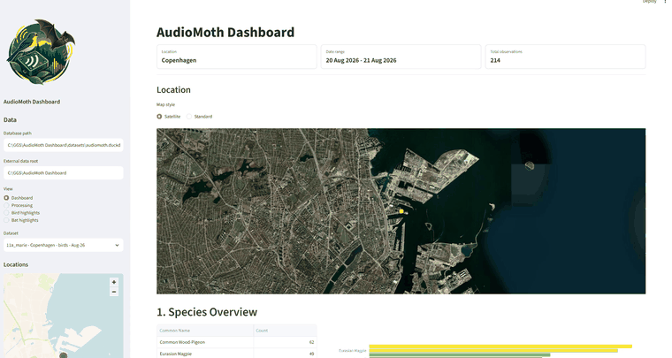

# AudioMoth Dashboard

AudioMoth Dashboard is a local Streamlit app for exploring AudioMoth recordings with Birda, BirdNET Analyzer, and BatDetect2 results. It can copy audio into dataset folders, run analyzers, generate a dataset manifest, build a DuckDB database, and browse detections with maps, species summaries, galleries, audio playback, and spectrograms.

The app is designed for local field-recording projects. Audio files, analyzer outputs, manifests, and DuckDB databases are ignored by Git by default.

## Demo



[Watch the higher-quality MP4 demo](docs/images/AudioMoth.mp4)

## Features

- Organize recordings into repeatable dataset folders.
- Run Birda, BirdNET Analyzer, or BatDetect2 from the Processing page.
- Use Birda as the recommended high-performance backend when its CUDA build is installed.
- Store Birda, BirdNET, and BatDetect2 outputs separately.
- Build or update a DuckDB database from a manifest.
- Browse detections by dataset, species, date, hour, confidence, and detector.
- Show species notes and media from Wikipedia when available.
- Play detections and render spectrograms from the linked audio file.
- Review best bird and bat recordings with detection-level mean dBFS metrics.

## Folder Layout

```text
AudioMoth Dashboard/
  install_requirements.py
  requirements.txt
  run_dashboard.py
  README.md
  dashboard/
    app.py
    assets/
      audiomoth-bird-bat-logo.png
      audiomoth-bird-bat-logo-sidebar.png
  scripts/
    build_db.py
    generate_manifest.py
    run_batdetect2.py
    datasets_manifest.example.csv
  datasets/
    .gitkeep
```

Local data is created under `datasets/`:

```text
datasets/
  datasets_manifest.csv
  audiomoth.duckdb
  01_example_location/
    audio/
    birda/
    birdnet/
    batdetect2_outputs/
```

`datasets/` is intentionally ignored by Git except for `.gitkeep`.

## Install

From the project root:

```powershell
python install_requirements.py
```

The installer creates a local virtual environment at `.venv/` and installs everything from `requirements.txt`. It prefers `uv` when available and otherwise falls back to `pip`.

To force a specific installer:

```powershell
python install_requirements.py --installer uv
python install_requirements.py --installer pip
```

To deliberately install into your current/global Python, add `--system`. This is not recommended because it may need administrator permissions.

```powershell
python install_requirements.py --system
```

## Run

```powershell
python run_dashboard.py
```

The launcher starts Streamlit at:

```text
http://localhost:8502
```

Optional arguments:

```powershell
python run_dashboard.py --port 8503
python run_dashboard.py --data-root "D:\AudioMoth Projects"
python run_dashboard.py --db "D:\AudioMoth Projects\datasets\audiomoth.duckdb"
```

By default, the app uses the project folder as the data root and stores the database at `datasets/audiomoth.duckdb`.

## First Launch

A manifest is not required before first launch.

On a clean clone, the app creates `datasets/` automatically. The dashboard view will show a setup message until a database exists. Open `Processing` in the sidebar and follow this order:

1. Create or select a dataset folder.
2. Copy or place audio files in that dataset's `audio/` folder.
3. Run bird detection with Birda or BirdNET Analyzer, and bat detection with BatDetect2.
4. Press `Regenerate manifest`.
5. Press `Append to database` for a new dataset.
6. Use `Rebuild listed datasets` if you re-ran analyzer outputs for an existing dataset.
7. Optionally create playback clips from the database detections.

The manifest is generated by scanning dataset folders. It is not generated automatically before any dataset folder exists.

## Dataset Structure

Each dataset folder can contain birds, bats, or both:

```text
datasets/
  01_site_name/
    audio/
      20230701_221500.WAV
    birda/
      20230701_221500.BirdNET.results.csv
    birdnet/
      20230701_221500.BirdNET.selection.table.txt
    batdetect2_outputs/
      20230701_221500.WAV.csv
```

Birda output should stay in `birda/`. BirdNET Analyzer output should stay in `birdnet/`. BatDetect2 output should stay in `batdetect2_outputs/`. This keeps detector provenance explicit in the database.

Playback clips can be generated from the Processing page after the database has been updated. The clipper uses all database detections that share the selected dataset's `audio/` folder, so bird and bat detections protect the same original WAV files. Overlapping detection windows are merged into one clip, using a configurable confidence threshold and margin before/after each detection. Clips are written to `clips/` with a `clips_manifest.csv`; original WAV files are not deleted by the app.

See [docs/data-structure.md](docs/data-structure.md) for more detail.

## Manual Commands

Generate or update the manifest:

```powershell
python scripts\generate_manifest.py --data-root "."
```

Build or update the database from the manifest:

```powershell
python scripts\build_db.py --data-root "."
```

Append new detections without replacing existing datasets:

```powershell
python scripts\build_db.py --data-root "." --append
```

Replace the whole database from the current manifest:

```powershell
python scripts\build_db.py --data-root "." --replace-db
```

Only compute missing detection-level audio metrics:

```powershell
python scripts\build_db.py --data-root "." --audio-metrics-only
```

Run BatDetect2 manually:

```powershell
python scripts\run_batdetect2.py --audio-dir "datasets\01_site_name\audio"
```

By default, the BatDetect2 helper skips audio files that already have matching `.csv` or `.json` outputs in `batdetect2_outputs/`. This is useful when you add extra WAV files to an existing dataset. For the older BatDetect2 CLI, the helper saves empty prediction files too, so progress can advance for recordings with no bat detections. To deliberately recompute every file, add:

```powershell
python scripts\run_batdetect2.py --audio-dir "datasets\01_site_name\audio" --rerun-existing
```

Birda is an optional external binary rather than a Python package in `requirements.txt`. For best performance on Windows/NVIDIA systems, install the Birda CUDA release from [tphakala/birda](https://github.com/tphakala/birda), add `birda.exe` to PATH, install a model with `birda models install birdnet-v24`, then restart the dashboard. TensorRT can be enabled separately by copying the TensorRT 10 DLLs into the Birda installation folder. The Processing page can then run Birda with GPU, TensorRT, batch-size, BirdNET/Perch model, and BattyBirdNET region settings.

## Public Repository Notes

Do not commit real field recordings, generated analyzer outputs, or DuckDB databases unless you explicitly intend to publish those data. The included `.gitignore` keeps these local by default.

For troubleshooting, see [docs/troubleshooting.md](docs/troubleshooting.md).

## Acknowledgements

AudioMoth Dashboard uses external bioacoustic tools through their published Python packages and command-line interfaces:

- [BirdNET Analyzer](https://github.com/birdnet-team/BirdNET-Analyzer) for bird and wildlife sound classification.
- [BatDetect2](https://github.com/macaodha/batdetect2) for detecting and classifying bat echolocation calls.
- [Birda](https://github.com/tphakala/birda) as an optional high-performance CLI backend for BirdNET, Perch, and BattyBirdNET models.

These projects are installed as dependencies from `requirements.txt` and are called by the dashboard during processing. This repository does not vendor, redistribute, or modify their source code. Please refer to the respective projects for their documentation, licenses, citation guidance, and model details.

## License

This project is released under the MIT License. See [LICENSE](LICENSE).
