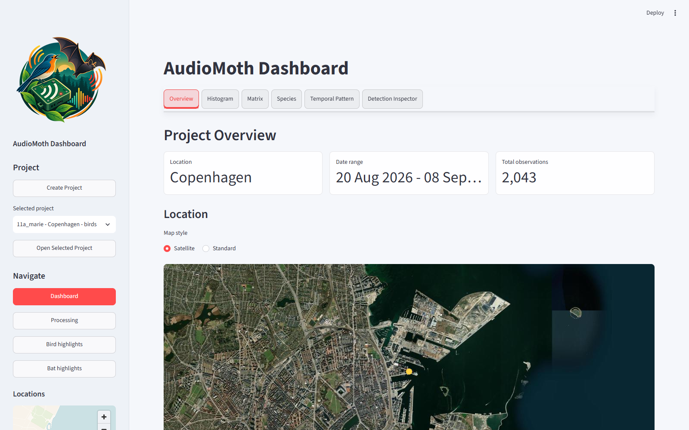
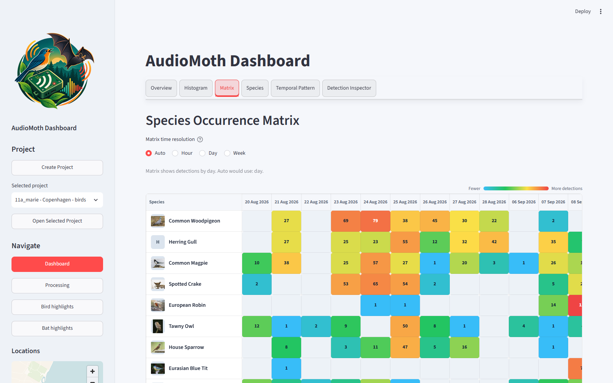
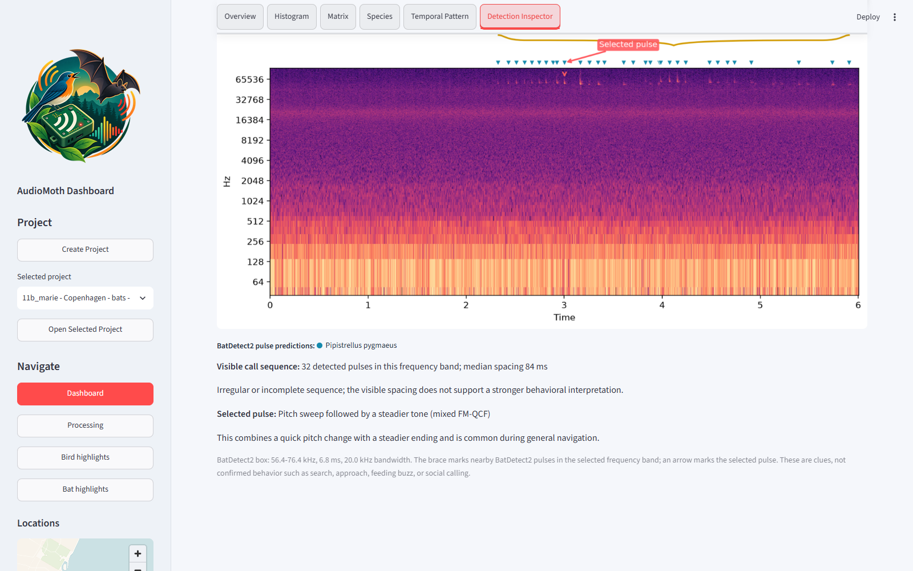

# AudioMoth Dashboard

AudioMoth Dashboard is a local Streamlit app for exploring AudioMoth recordings with Birda, BirdNET Analyzer, and BatDetect2 results. It can copy audio into dataset folders, run analyzers, generate a dataset manifest, build a DuckDB database, and browse detections with maps, species summaries, galleries, audio playback, and spectrograms.

The app is designed for local field-recording projects. Audio files, analyzer outputs, manifests, and DuckDB databases are ignored by Git by default.

## About AudioMoth

[AudioMoth](https://www.openacousticdevices.info/audiomoth) is a low-cost, open-source, full-spectrum acoustic logging device developed by [Open Acoustic Devices](https://www.openacousticdevices.info/). It records uncompressed WAV files to a microSD card at audible and ultrasonic sample rates, making it useful for passive monitoring of birds, bats, other wildlife, and environmental sound.

This repository is an independent companion application for organizing, analyzing, and exploring recordings made with AudioMoth and compatible recorders. It is not an official Open Acoustic Devices application and does not replace the AudioMoth configuration software.

## Screenshots

### Project overview



### Species occurrence matrix



### Bat detection inspection



## Features

- Organize recordings into repeatable dataset folders.
- Run Birda, BirdNET Analyzer, or BatDetect2 from the Processing page.
- Use Birda as the recommended high-performance backend when its CUDA build is installed.
- Store Birda, BirdNET, and BatDetect2 outputs separately.
- Build or update a DuckDB database from a manifest.
- Browse detections by dataset, species, date, hour, confidence, and detector.
- Show species notes and media from Wikipedia, with a persistent local cache for fast and offline reuse after the first successful lookup.
- Select a detection directly from the inspector table to load its audio and spectrogram.
- Prefer generated playback clips when available, including 10x time expansion for ultrasonic bat calls.
- Inspect BatDetect2 pulse predictions, frequency-band sequences, pulse spacing, and cautious plain-language call-shape notes.
- Review and rank recordings using classifier confidence, signal-to-noise ratio, and detection-level dBFS metrics.

## Folder Layout

```text
AudioMoth Dashboard/
  install_requirements.py
  requirements.txt
  run_dashboard.py
  README.md
  dashboard/
    app.py
    assets/
      audiomoth-bird-bat-logo.png
      audiomoth-bird-bat-logo-sidebar.png
  scripts/
    build_db.py
    generate_manifest.py
    install_demo.py
    run_batdetect2.py
    datasets_manifest.example.csv
  demo_data/
    datasets/
      demo_copenhagen_birds/
      demo_copenhagen_bats/
  datasets/
    .gitkeep
```

Local data is created under `datasets/`:

```text
datasets/
  datasets_manifest.csv
  audiomoth.duckdb
  01_example_location/
    audio/
    birda/
    birdnet/
    batdetect2_outputs/
```

`datasets/` is intentionally ignored by Git except for `.gitkeep`.

## Install

The dashboard is primarily developed and tested on Windows with Python 3.13. The launcher also supports the conventional `.venv/bin/python` layout on macOS and Linux, but the external analyzer setup and native folder picker can vary by operating system.

From the project root:

```powershell
python install_requirements.py
```

The installer creates a local virtual environment at `.venv/` and installs everything from `requirements.txt`. It prefers `uv` when available and otherwise falls back to `pip`. At the end of an interactive first installation, it asks `Would you like to install the Copenhagen demo projects now? [y/N]`. Answer `y` to install the six-recording sample and build its database immediately, or press Enter to continue without it.

After installing the Python packages, it also checks the optional Birda integration. When Birda is present, the check reports its version, configured models, and available CPU/GPU providers. When it is absent, the installer prints the current Windows installation and model-setup instructions. A missing Birda executable does not fail the Python installation or disable BirdNET Analyzer.

To force a specific installer:

```powershell
python install_requirements.py --installer uv
python install_requirements.py --installer pip
```

To omit the optional Birda check, for example in automated Python-only installations:

```powershell
python install_requirements.py --skip-birda-check
```

For unattended setup, choose the demo behavior explicitly:

```powershell
python install_requirements.py --install-demo
python install_requirements.py --no-demo
```

Non-interactive installations never wait for an answer. Without `--install-demo`, they skip the demo and print the command for installing it later.

To deliberately install into your current/global Python, add `--system`. This is not recommended because it may need administrator permissions.

```powershell
python install_requirements.py --system
```

## Run

```powershell
python run_dashboard.py
```

The launcher starts Streamlit at:

```text
http://localhost:8502
```

Optional arguments:

```powershell
python run_dashboard.py --port 8503
python run_dashboard.py --data-root "D:\AudioMoth Projects"
python run_dashboard.py --db "D:\AudioMoth Projects\datasets\audiomoth.duckdb"
```

By default, the app uses the project folder as the data root and stores the database at `datasets/audiomoth.duckdb`.

## First Launch

A manifest is not required before first launch.

On a clean clone, the app creates `datasets/` automatically. The dashboard view will show a setup message until a database exists. To explore the interface immediately, press **Install demo projects**. This installs two compact Copenhagen projects with three bird WAVs, three ultrasonic bat WAVs, and their existing Birda/BatDetect2 results. No analyzer installation is needed for the core demo; Wikipedia profiles and images still require a first successful online lookup before they are cached locally.

The same action is available from the command line:

```powershell
python scripts\install_demo.py
```

To begin with your own recordings instead, open `Processing` in the sidebar and follow this order:

1. Create or select a dataset folder.
2. Copy or place audio files in that dataset's `audio/` folder.
3. Run bird detection with Birda or BirdNET Analyzer, and bat detection with BatDetect2.
4. Press `Regenerate manifest`.
5. Press `Append to database` for a new dataset.
6. Use `Rebuild listed datasets` if you re-ran analyzer outputs for an existing dataset.
7. Optionally create playback clips from the database detections.

The manifest is generated by scanning dataset folders. It is not generated automatically before any dataset folder exists.

The demo recordings were contributed by Florian W.H. Smit. They use city-level Copenhagen metadata and do not expose their original private file paths. See [`demo_data/README.md`](demo_data/README.md) for recording rights and attribution.

## Dataset Structure

Each dataset folder can contain birds, bats, or both:

```text
datasets/
  01_site_name/
    audio/
      20230701_221500.WAV
    birda/
      20230701_221500.BirdNET.results.csv
    birdnet/
      20230701_221500.BirdNET.selection.table.txt
    batdetect2_outputs/
      20230701_221500.WAV.csv
```

Birda output should stay in `birda/`. BirdNET Analyzer output should stay in `birdnet/`. BatDetect2 output should stay in `batdetect2_outputs/`. This keeps detector provenance explicit in the database.

Playback clips can be generated from the Processing page after the database has been updated. The clipper uses all database detections that share the selected dataset's `audio/` folder, so bird and bat detections protect the same original WAV files. Balanced, curated, and broad presets make the quality controls approachable; Custom exposes confidence, minimum-SNR, maximum-background-dBFS, and per-species limits. The best detections per species are ranked using 50% confidence, 35% SNR, and 15% background quietness. Processing also provides confidence/SNR analytics and 15-minute signal, background, and SNR timelines. Overlapping windows are merged using the selected margin. A live estimate compares the projected quality-clip size with the source WAV collection before export. Clips are written to `clips/` with a `clips_manifest.csv`; original WAV files are not deleted by the app.

See [docs/using-the-dashboard.md](docs/using-the-dashboard.md) for the interface guide and [docs/data-structure.md](docs/data-structure.md) for data details.

## Manual Commands

Generate or update the manifest:

```powershell
python scripts\generate_manifest.py --data-root "."
```

Build or update the database from the manifest:

```powershell
python scripts\build_db.py --data-root "."
```

To rebuild only one project represented by multiple manifest rows:

```powershell
python scripts\build_db.py --data-root "." --dataset-id 11a_site --dataset-id 11b_site
```

Append new detections without replacing existing datasets:

```powershell
python scripts\build_db.py --data-root "." --append
```

Replace the whole database from the current manifest:

```powershell
python scripts\build_db.py --data-root "." --replace-db
```

Only compute missing detection-level audio metrics:

```powershell
python scripts\build_db.py --data-root "." --audio-metrics-only
```

This incrementally fills mean level, detected-signal level, local background-noise level, and estimated SNR. Existing complete rows are left unchanged. Use `--refresh-audio-metrics` only when all quality metrics should be recalculated.

Run BatDetect2 manually:

```powershell
python scripts\run_batdetect2.py --audio-dir "datasets\01_site_name\audio"
```

By default, the BatDetect2 helper skips audio files that already have matching `.csv` or `.json` outputs in `batdetect2_outputs/`. This is useful when you add extra WAV files to an existing dataset. For the older BatDetect2 CLI, the helper saves empty prediction files too, so progress can advance for recordings with no bat detections. To deliberately recompute every file, add:

```powershell
python scripts\run_batdetect2.py --audio-dir "datasets\01_site_name\audio" --rerun-existing
```

Birda is an optional external binary rather than a Python package in `requirements.txt`. The requirements installer checks whether it is ready and prints setup instructions when needed. For best performance on Windows/NVIDIA systems, install the Birda CUDA release from [Birda Releases](https://github.com/tphakala/birda/releases/latest), add `birda.exe` to PATH, install a model with `birda models install birdnet-v24`, then restart PowerShell and the dashboard. See the [Birda Windows guide](https://github.com/tphakala/birda/blob/main/docs/windows-guide.md) for CUDA and optional TensorRT setup. The Processing page can then run Birda with GPU, TensorRT, batch-size, BirdNET/Perch model, and BattyBirdNET region settings.

## Public Repository Notes

Do not commit real field recordings, generated analyzer outputs, or DuckDB databases unless you explicitly intend to publish those data. The included `.gitignore` keeps these local by default.

For troubleshooting, see [docs/troubleshooting.md](docs/troubleshooting.md).

Classifier results are model predictions, not verified species records or animal-abundance estimates. Review important detections manually and follow the documentation and citation guidance of the analyzer and model you use.

Contributions and bug reports are welcome. See [CONTRIBUTING.md](CONTRIBUTING.md). Academic users can find citation metadata in [CITATION.cff](CITATION.cff), and security-reporting guidance is in [SECURITY.md](SECURITY.md).

## Acknowledgements

AudioMoth Dashboard uses external bioacoustic tools through their published Python packages and command-line interfaces:

- [BirdNET Analyzer](https://github.com/birdnet-team/BirdNET-Analyzer) for bird and wildlife sound classification.
- [BatDetect2](https://github.com/macaodha/batdetect2) for detecting and classifying bat echolocation calls.
- [Birda](https://github.com/tphakala/birda) as an optional high-performance CLI backend for BirdNET, Perch, and BattyBirdNET models.

BirdNET Analyzer and BatDetect2 are installed from `requirements.txt` and called through their published interfaces. Birda is installed separately as an optional command-line tool. This repository does not vendor, redistribute, or modify any of their source code. Please refer to the respective projects for their documentation, licenses, citation guidance, and model details.

## License

This project is released under the MIT License. See [LICENSE](LICENSE).
